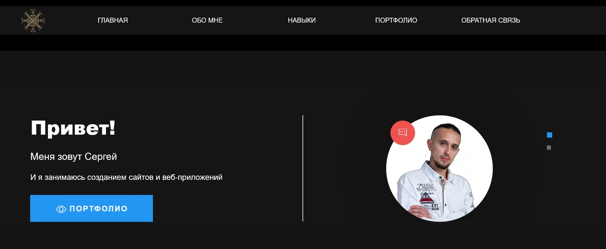
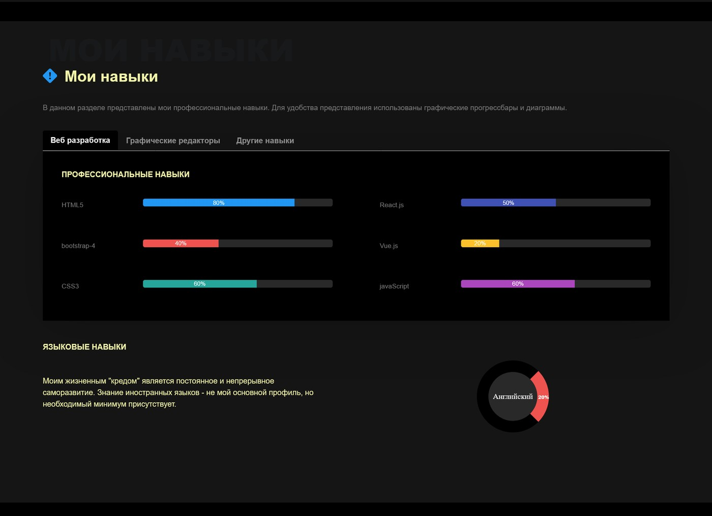
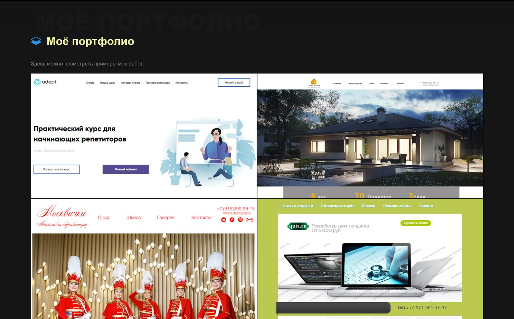
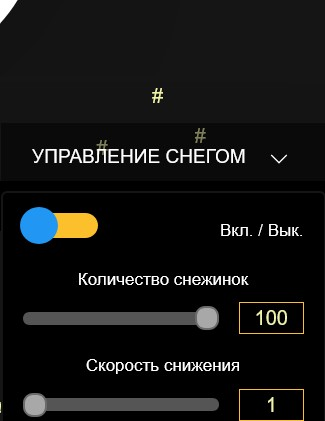

# Personal Portfolio

A one-page portfolio website built with Vue.js. It brings together information about me, my skills and selected projects, with a few interactive elements.

## Screenshots

### Home



### Skills



### Portfolio



### Snow settings



## Features

- One-page layout with navigation between page sections.
- Sections with personal information, skills and selected projects.
- Additional navigation menu available while scrolling.
- Slide-out side panel opened with a button.
- Snow effect settings, including an on/off switch and the number of snowflakes.

Some parts of the original snow effect are not fully available in the current version. The snowflake images were previously loaded dynamically and are not included in this repository setup. The speed control is visible in the interface but is currently not working.

The contact form interface is present, but successful message delivery has not been verified. A working server-side handler is required to process form submissions.

## Tech stack

- Vue 2
- Vue Router 3
- Vuex 3
- JavaScript
- SCSS / Sass
- Bootstrap 4
- Materialize CSS
- Axios
- Vuelidate
- Vue CLI 4

## Requirements

- Node.js
- npm

## Getting started

Clone the repository and install the dependencies:

```bash
git clone https://github.com/KutuzovSergey/my-website.git
cd my-website
npm install
```

Start the development server:

```bash
npm run serve
```

The development server will print the local URL in the terminal.

## Available scripts

| Command | Description |
| --- | --- |
| `npm run serve` | Starts the development server. |
| `npm run build` | Builds the project for production. |
| `npm run lint` | Runs ESLint checks. |

## Project structure

```text
src/
├── components/   Reusable page sections and interface components
├── router/       Vue Router configuration
├── store/        Vuex store and modules
├── views/        Page-level components
├── App.vue       Root component
└── main.js       Application entry point
```

## Notes

This project uses Vue 2 and Vue CLI 4. Some dependencies belong to older versions of the Vue ecosystem. The repository keeps the original project stack; a framework migration or dependency upgrade is not part of this project description.

## Author

Sergey Kutuzov

- GitHub: [KutuzovSergey](https://github.com/KutuzovSergey)
